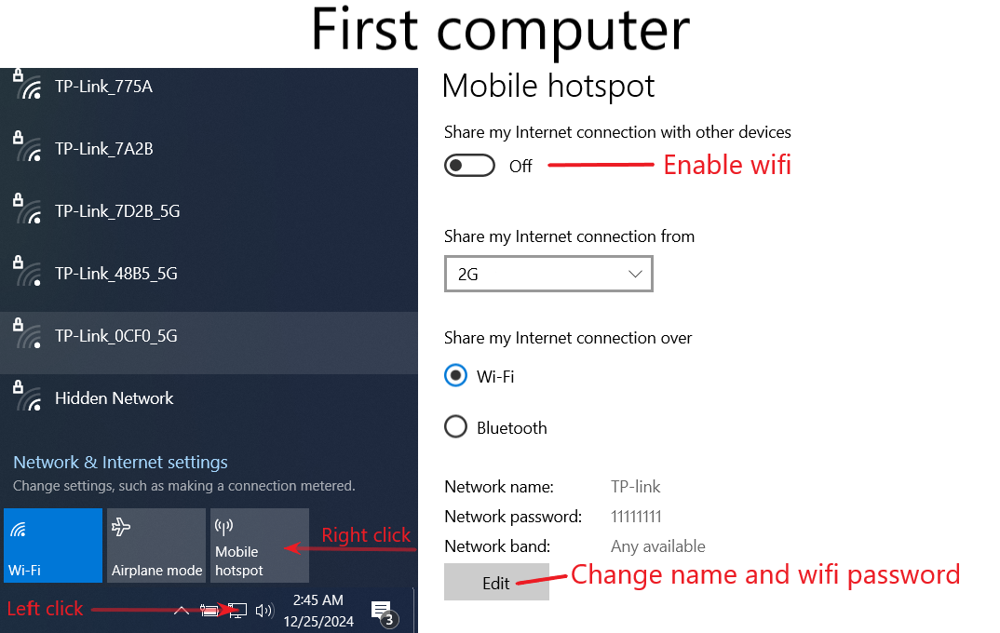
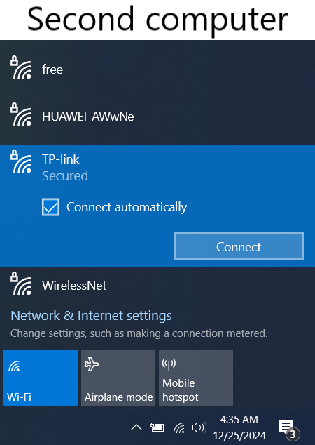
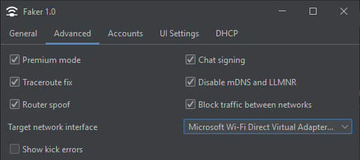
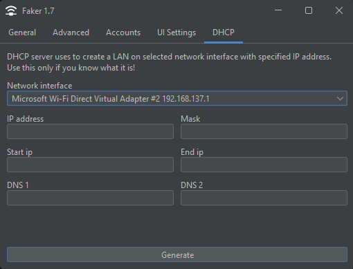

# Faker
MITM proxy for Minecraft: Java Edition for bypass screenshares. 

Allows you to connect from two Minecraft client to server with same account.
Intended for use on two computers.

Support full IP interception so that clients connects to the real server IP.

Inspired by [ViaProxy](https://github.com/ViaVersion/ViaProxy).

## Supported Minecraft versions
-  ### 1.7.2 - 26.2

## [Download](https://github.com/o1seth/faker/releases/latest)

## Table of Contents
### 1. [How to use](#how-to-use)
### 2. [How to bypass "faker detection scripts"](#how-to-bypass-faker-detection-scripts)

## How to use
First of all, you must have two Wi-Fi adapters: for first and second computers. If you have a laptop, it should already have Wi-Fi.

1. Setup and enable Wi-Fi mobile hotspot on first computer:</br>


2. Connect from second computer to created Wi-Fi:</br>

3. Run Faker on first computer. Download and run Faker on second computer **is not needed**.
4. Open ```Advanced``` tab, Make sure that ```Target network interface``` is set to something like ```Microsoft Wi-Fi Direct Virtual Adapter...```:</br>

5. Select ```Premium mode``` and ```Chat singing``` if you want to play on premium servers. Also add Microsoft account on ```Accounts``` tab. If you are going to play on a server without premium mode (no license) skip this step.
6. General -> Start.
7. Run minecraft on both computers. Use same version of minecraft. etc.: ```1.21.4 and 1.21.4``` or ```Feather 1.21.4 and Vanilla 1.21.4```.
8. Connect to the same server (etc. ```mc.hypixel.net```) from both computers. Minecraft will freeze on "Connecting..." until second client connects. You have about 20 seconds to connect the second client.
9. Use your Minecraft client with "Utility mods" on first computer for playing. 
10. Use your clean Minecraft client on second computer for pass screenshares.
11. To bypass more advanced screenshares, refer to [How to bypass "faker detection scripts"](#how-to-bypass-faker-detection-scripts)

## How to bypass "faker detection scripts"

Faker detection scripts detect faker by scanning the clean PC for the default Windows Internet Connection Sharing (ICS) Gateway IP (`192.168.137.1` or `192.168.137.x`).

To bypass, we can use the built-in DHCP tab.

1. Setup and enable Wi-Fi mobile hotspot on first computer. **Do not connect the second computer yet.**

3. Run Faker on first computer. **Do not download faker on second computer.**
3. Open ```Advanced``` tab, Make sure that ```Target network interface``` is set to something like ```Microsoft Wi-Fi Direct Virtual Adapter...```:</br>
    

3. **Open the DHCP Tab**: Navigate to the **DHCP** tab at the top of Faker.
4. In the ```Network interface``` dropdown, choose your **`Microsoft Wi-Fi Direct Virtual Adapter`** (**select the same as  ```Target network interface``` in the above step**).
5. **Generate a DHCP**:
   - Ensure the **IP address** field is blank/cleared.
   - The button at the bottom will change to say **Generate**.
   - Click **Generate**.
   
6. **Start the DHCP Server**: Click the **Start** button at the bottom.
7. **Connect the Second Computer**: Connect Computer 2 to your mobile hotspot Wi-Fi. 
8. **Follow instructions from step 5 of [How to use](#how-to-use)**

> **Tip:** Do not name your Hotspot network name (SSID) with a common name (such as `iPhone`, `Android`, `Galaxy`, `Pixel`, etc.)


